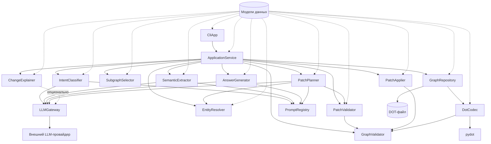
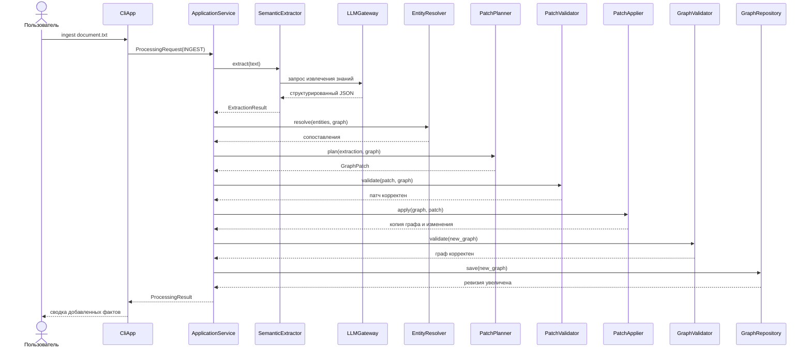
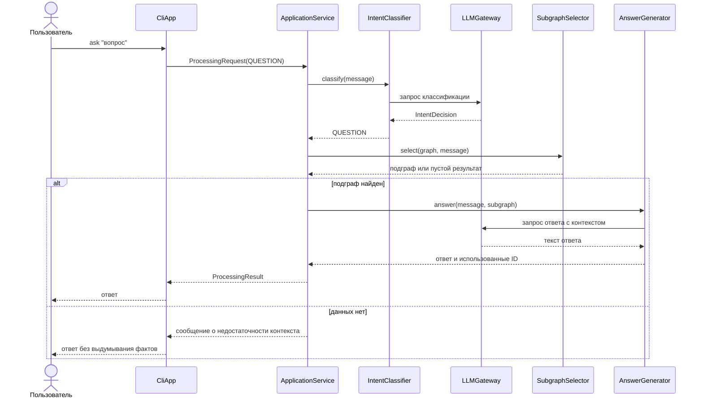
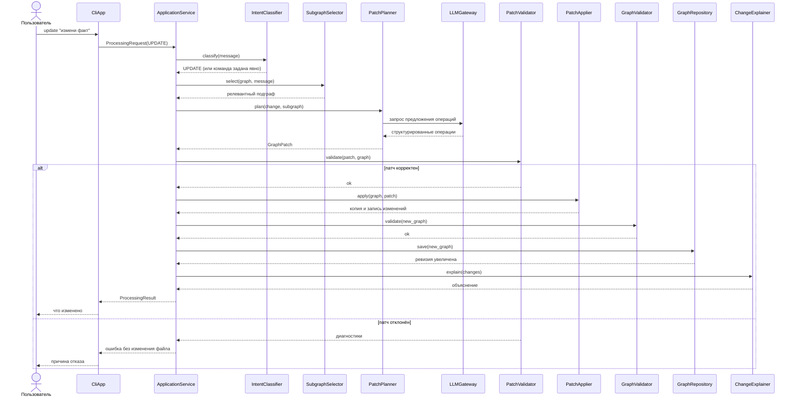

# Архитектура приложения

## Статус и границы

Документ фиксирует архитектуру MVP: один локальный семантический граф, текстовые входные данные, интерфейс командной строки, локальные файлы вместо внешней базы данных. Формат хранения описан в [dot-storage.md](dot-storage.md), изменения графа — в [graph-patches.md](graph-patches.md).

Спецификации семантической модели и контрактов LLM ещё не написаны. Поэтому состав атрибутов узлов и связей, структура `ExtractionResult` и точные схемы ответов LLM в документе предварительные. После появления `docs/semantic-model.md` и `docs/llm-contracts.md` документ нужно сверить с ними; расхождения разрешаются в пользу специализированных спецификаций.

## Архитектурные принципы

1. **Вероятностная и детерминированная части разделены.** LLM предлагает структурированные данные, но не изменяет граф и не пишет файл. Все проверки, преобразования и сохранение выполняет Python-код.
2. **DOT-файл — основное сохраняемое представление модели.** В памяти граф существует как типизированные объекты, но источником истины между запусками остаётся файл.
3. **Любое изменение проходит через патч.** Добавление, изменение и удаление узлов и связей описываются операциями `GraphPatch`, а не прямыми мутациями.
4. **Зависимости направлены внутрь.** Доменный слой не знает о LLM, файловой системе и CLI. Внешние системы подключаются через адаптеры.
5. **Идентификаторы стабильны.** ID не выводится из названия и не зависит от позиции объекта в файле.
6. **Основные тесты не требуют сети.** LLM подменяется тестовой реализацией, файловые операции выполняются во временных каталогах.
7. **Изменения атомарны.** Патч применяется к копии графа; при ошибке исходный граф и файл остаются неизменными.

## Слои

| Слой | Компоненты | Может зависеть от | Не должен зависеть от |
|---|---|---|---|
| Interface | `CliApp` | Application, конфигурация | Domain, LLM, файловая система напрямую |
| Application | `ApplicationService` | доменные сервисы, адаптеры через интерфейсы | конкретного LLM-провайдера, `pydot`, CLI |
| LLM Processing | `LLMGateway`, `PromptRegistry`, `SemanticExtractor`, `IntentClassifier`, `AnswerGenerator`, `ChangeExplainer` | порт `LLMGateway`, модели данных | `pydot`, файловой системы, CLI |
| Graph Domain | модели данных, `GraphValidator`, `PatchValidator` | только модели данных и стандартную библиотеку | LLM, файловой системы, CLI, `pydot` |
| Graph Operations | `SubgraphSelector`, `EntityResolver`, `PatchPlanner`, `PatchApplier` | модели данных, доменные сервисы, порт LLM | файловой системы, CLI |
| Persistence | `DotCodec`, `GraphRepository` | `pydot`, модели данных, `GraphValidator` | LLM, CLI |
| Testing | `FakeLLMGateway`, фикстуры | порты и модели | сети и реальных API-ключей |

Направление зависимостей: Interface → Application → (LLM Processing, Graph Operations, Persistence) → Graph Domain. Обратные импорты запрещены.

## Типы компонентов

- **Модели данных** — неизменяемые типизированные объекты (`SemanticNode`, `SemanticEdge`, `SemanticGraph`, `GraphPatch`, `IntentDecision`, `ExtractionResult`, `ProcessingRequest`, `ProcessingResult`). Не содержат ввода-вывода и бизнес-правил; валидируют обязательные поля и типы при создании.
- **Доменные сервисы** — детерминированные операции над моделями: проверка инвариантов, выбор подграфа, сопоставление сущностей, применение патча. Не обращаются к внешним системам.
- **Адаптеры внешних систем** — `LLMGateway` (порт и реализации провайдеров), `DotCodec` (`pydot` ↔ модели), `GraphRepository` (файловая система). Инкапсулируют формат, сетевые ошибки и особенности библиотек.
- **Прикладной координатор** — `ApplicationService`. Связывает сценарии, но не содержит правил графа и не работает с внешними API напрямую.
- **Интерфейс** — `CliApp`. Разбирает аргументы, вызывает координатор, печатает результат и возвращает код завершения.

## Каталог компонентов

Для каждого компонента указаны вход, результат, ошибки и зависимости. Коды диагностики, уже зафиксированные в спецификациях формата, используются повторно.

### Доменный слой

#### GraphValidator

- **Вход:** `SemanticGraph`.
- **Результат:** список диагностик; пустой список означает корректный граф.
- **Ошибки:** `DUPLICATE_ID`, `MISSING_NODE`, `INVALID_ATTRIBUTE`, `INVALID_GRAPH`; неподдерживаемая версия схемы указывается явно.
- **Зависимости:** только модели данных и стандартная библиотека.
- **Ответственность:** уникальность ID узлов и связей, существование обоих концов связи, обязательные атрибуты, версия схемы, допустимость петель и циклов.

#### PatchValidator

- **Вход:** `GraphPatch`, текущий `SemanticGraph`.
- **Результат:** проверенный патч либо список диагностик с индексом операции.
- **Ошибки:** `INVALID_PATCH`, `REVISION_MISMATCH`, `MISSING_OBJECT`, `DUPLICATE_OPERATION`, `INVALID_ATTRIBUTE`, `MISSING_NODE`.
- **Зависимости:** модели данных, `GraphValidator` для итоговой проверки.
- **Ответственность:** структура JSON-патча, совпадение `base_revision`, существование изменяемых объектов, отсутствие конфликтующих операций, допустимость удаления узла только после удаления его связей.

### Слой операций над графом

#### PatchApplier

- **Вход:** `SemanticGraph`, патч, прошедший `PatchValidator`.
- **Результат:** новая копия графа, запись изменений (до/после, затронутые ID) и признак фактического изменения.
- **Ошибки:** `APPLY_CONFLICT` — защитная диагностика при нарушении предусловий, которая не должна возникать после успешной проверки.
- **Зависимости:** модели данных.
- **Ответственность:** последовательное применение операций к независимой копии, увеличение ревизии только при фактическом изменении.

#### SubgraphSelector

- **Вход:** `SemanticGraph`, текст запроса, лимиты узлов и связей, глубина обхода.
- **Результат:** релевантный подграф, список совпавших сущностей, признак усечения по лимиту.
- **Ошибки:** `INVALID_LIMIT`.
- **Зависимости:** модели данных; алгоритм детерминирован и не требует LLM.
- **Ответственность:** поиск по названиям, типам и ключевым словам, обход смежных узлов на ограниченную глубину, обработка пустого результата и нескольких подходящих сущностей.

#### EntityResolver

- **Вход:** новые сущности из `ExtractionResult`, существующий граф или его подграф.
- **Результат:** сопоставление «новая сущность → существующий ID или новая сущность», список неоднозначных случаев.
- **Ошибки:** `INVALID_ENTITY`.
- **Зависимости:** модели данных.
- **Ответственность:** предлагать сопоставления по явным признакам; совпадение названий само по себе не считается доказательством тождественности. Спорные случаи возвращаются на уточнение.

#### PatchPlanner

- **Вход:** `ExtractionResult` или запрос на изменение, текущий граф, результат `EntityResolver`.
- **Результат:** `GraphPatch` с `base_revision` и операциями.
- **Ошибки:** `PATCH_PLANNING_FAILED`, `NO_CHANGES`, `LLM_INVALID_RESPONSE`.
- **Зависимости:** модели данных, `EntityResolver`, порт `LLMGateway` и `PromptRegistry` для запросов на естественном языке.
- **Ответственность:** преобразование структурированного предложения LLM в допустимые операции; проверка принадлежности ID и отсутствие прямого редактирования файла.

### Слой обработки LLM

#### LLMGateway

- **Вход:** имя операции, сообщения промпта, параметры модели (имя, температура, максимальный размер ответа, тайм-аут).
- **Результат:** структурированный ответ провайдера и метаданные (использованная модель, расход токенов при наличии).
- **Ошибки:** `LLM_UNAVAILABLE`, `LLM_TIMEOUT`, `LLM_RATE_LIMIT`, `LLM_INVALID_RESPONSE`.
- **Зависимости:** SDK конкретного провайдера; порт не зависит от домена.
- **Ответственность:** единый интерфейс смены провайдера, тайм-ауты, преобразование ответа в JSON. Реализации: провайдер по умолчанию и `FakeLLMGateway` для тестов.

#### PromptRegistry

- **Вход:** имя операции, типизированный контекст.
- **Результат:** раздельные системная инструкция и пользовательские данные.
- **Ошибки:** `UNKNOWN_PROMPT`, `INVALID_CONTEXT`.
- **Зависимости:** шаблоны промптов; не обращается к LLM.
- **Ответственность:** версионируемые шаблоны, передача только необходимого контекста, отделение инструкций от пользовательского текста.

#### SemanticExtractor

- **Вход:** текст документа.
- **Результат:** `ExtractionResult` — сущности, отношения, подтверждения и источники.
- **Ошибки:** `EXTRACTION_INVALID`, ошибки `LLMGateway`.
- **Зависимости:** `LLMGateway`, `PromptRegistry`, модели данных.
- **Ответственность:** извлечение знаний, проверка ответа по схеме, отказ от фактов, отсутствующих в тексте.

#### IntentClassifier

- **Вход:** сообщение пользователя.
- **Результат:** `IntentDecision` — категория (`QUESTION`, `UPDATE`, `INGEST`, `CLARIFICATION_REQUIRED`, `UNKNOWN`), уверенность, краткое основание, необходимость уточнения.
- **Ошибки:** `INVALID_INTENT_RESPONSE`, ошибки `LLMGateway`.
- **Зависимости:** `LLMGateway`, `PromptRegistry`, модели данных.
- **Ответственность:** классификация только при автоматическом режиме `process`; явная CLI-команда имеет приоритет и классификатор не вызывается.

#### AnswerGenerator

- **Вход:** сообщение пользователя и найденный подграф.
- **Результат:** текст ответа и список использованных узлов и связей.
- **Ошибки:** `LLM_INVALID_RESPONSE`, ошибки `LLMGateway`; недостаточность контекста является штатным результатом, а не исключением.
- **Зависимости:** `LLMGateway`, `PromptRegistry`, модели данных.
- **Ответственность:** ответ только на основании переданного контекста; при отсутствии данных — явное сообщение о недостаточности информации.

#### ChangeExplainer

- **Вход:** запись изменений от `PatchApplier` (операции, старые и новые значения, ревизии).
- **Результат:** человекочитаемое объяснение изменений.
- **Ошибки:** `EXPLANATION_FAILED`, ошибки `LLMGateway` при использовании модели.
- **Зависимости:** модели данных; в MVP допускается шаблонное объяснение без LLM.
- **Ответственность:** объяснение применённого патча; отклонённый патч не объясняется как изменение.

### Слой хранения

#### DotCodec

- **Вход:** строка DOT или `SemanticGraph`.
- **Результат:** `SemanticGraph` или детерминированная строка DOT.
- **Ошибки:** `INVALID_DOT`, `UNSUPPORTED_DOT`, `INVALID_ATTRIBUTE`, `DUPLICATE_ID`, `MISSING_NODE`.
- **Зависимости:** `pydot`, модели данных, `GraphValidator` для проверки результата.
- **Ответственность:** строгое поддерживаемое подмножество DOT, Unicode и экранирование, стабильная сортировка, отказ от молчаливой потери данных. Файловых операций не выполняет.

#### GraphRepository

- **Вход:** путь к файлу; для сохранения — граф и ожидаемая ревизия.
- **Результат:** загруженный граф либо подтверждение сохранения; для сохранения — новая ревизия.
- **Ошибки:** `FILE_NOT_FOUND`, `IO_ERROR`, `REVISION_CONFLICT`, а также диагностики `DotCodec` и `GraphValidator`.
- **Зависимости:** `DotCodec`, `GraphValidator`, файловая система.
- **Ответственность:** чтение и атомарная запись, проверка перед сохранением, обнаружение конкурентного изменения ревизии. Не содержит правил предметной модели.

### Прикладной и интерфейсный слои

#### ApplicationService

- **Вход:** `ProcessingRequest` — режим (явная команда или автоматическое определение), сообщение или документ, путь к модели, параметры.
- **Результат:** `ProcessingResult` — намерение, ответ, сводка патча, диагностики, признак изменения модели.
- **Ошибки:** агрегирует ошибки компонентов, не подменяя их коды.
- **Зависимости:** доменные сервисы и адаптеры, переданные через конструктор.
- **Ответственность:** координация сценариев «построить», «ответить», «обновить», «загрузить документ»; выбор последовательности вызовов; отсутствие прямой работы с LLM, `pydot` и файлами.

#### CliApp

- **Вход:** аргументы командной строки (`init`, `ingest`, `ask`, `update`, `process`, `show`, `validate`).
- **Результат:** вывод в stdout/stderr и код завершения.
- **Ошибки:** `CLI_USAGE`, `INVALID_INPUT`; остальные ошибки отображаются с сохранением исходного кода.
- **Зависимости:** `ApplicationService`, конфигурация.
- **Ответственность:** разбор аргументов, форматирование результата, преобразование категорий ошибок в коды завершения.

## Диаграмма компонентов

## Жизненный цикл SemanticGraph

1. **Создание.** `init` формирует пустой граф с `schema_version = "1"` и `revision = 0`, проверяет его и сохраняет через `GraphRepository`.
2. **Загрузка.** `GraphRepository` читает файл, `DotCodec` разбирает его, `GraphValidator` проверяет инварианты. При ошибке граф не публикуется в памяти и не исправляется автоматически.
3. **Использование.** Для чтения (`show`, `ask`) граф доступен только через операции доступа; выбор подграфа не изменяет исходный объект.
4. **Изменение.** Для патча создаётся независимая копия. Операции применяются к копии; исходный объект остаётся неизменным до успешной итоговой проверки.
5. **Публикация.** После успешной проверки копия становится новым состоянием, ревизия увеличивается на единицу, `GraphRepository` атомарно записывает файл. При ошибке сохранения новое состояние не публикуется.
6. **Ручное редактирование.** Файл остаётся источником истины: изменение, сделанное вручную, обнаруживается при следующей загрузке; ревизию должен увеличить редактор.

Граф не является потокобезопасным. В MVP предполагается один процесс и один писатель; защита от параллельных изменений и история ревизий относятся к последующим этапам.

## Жизненный цикл GraphPatch

1. **Формирование.** `PatchPlanner` создаёт патч из `ExtractionResult` или запроса на изменение. Патч содержит `base_revision` и непустой упорядоченный список операций.
2. **Синтаксическая проверка.** `PatchValidator` проверяет JSON-структуру, типы, обязательные поля, имена операций, формат ID и совпадение `base_revision`.
3. **Проверка относительно графа.** Операции проверяются по порядку с учётом предыдущих операций того же патча: новые ID свободны, изменяемые и удаляемые объекты существуют, концы добавляемых связей существуют к моменту операции, конфликтующие операции отсутствуют.
4. **Применение к копии.** `PatchApplier` применяет операции к независимой копии. Частичный результат не публикуется.
5. **Итоговая валидация.** `GraphValidator` проверяет итоговый граф целиком, включая уникальность ID и ссылочную целостность.
6. **Сохранение и объяснение.** При успехе `GraphRepository` записывает граф с новой ревизией, `ChangeExplainer` формирует описание изменений. При любой ошибке исходный граф, файл и ревизия остаются без изменений; возвращаются диагностики с индексом операции.

## Сценарии обработки запросов

### Построение модели из документа

### Ответ на вопрос

### Точечное обновление модели

Явные команды `ask` и `update` не требуют классификатора; автоматический режим `process` вызывает его для выбора сценария. Загрузка большого документа отличается от `ingest` только режимом разбиения текста и последующим объединением знаний; последовательность проверки и сохранения остаётся общей.

## Ошибки и коды завершения

| Категория | Примеры кодов | Код завершения CLI |
|---|---|---|
| Успех | — | `0` |
| Неверный ввод или аргументы | `CLI_USAGE`, `INVALID_INPUT`, `INVALID_LIMIT` | `2` |
| Ошибка LLM | `LLM_UNAVAILABLE`, `LLM_TIMEOUT`, `LLM_RATE_LIMIT`, `LLM_INVALID_RESPONSE`, `EXTRACTION_INVALID`, `INVALID_INTENT_RESPONSE`, `PATCH_PLANNING_FAILED` | `3` |
| Ошибка хранения | `FILE_NOT_FOUND`, `IO_ERROR`, `REVISION_CONFLICT` | `4` |
| Ошибка модели или патча | `INVALID_GRAPH`, `INVALID_DOT`, `UNSUPPORTED_DOT`, `INVALID_ATTRIBUTE`, `DUPLICATE_ID`, `MISSING_NODE`, `INVALID_PATCH`, `REVISION_MISMATCH`, `MISSING_OBJECT`, `DUPLICATE_OPERATION`, `APPLY_CONFLICT` | `5` |

Коды завершения и точный формат сообщений окончательно фиксируются в `docs/user-scenarios.md`. Диагностика должна содержать код, понятное сообщение и, когда это возможно, путь к файлу, индекс операции и идентификатор проблемного объекта.

## Архитектурные решения

Записи ADR находятся в [docs/adr](adr/README.md):

- [ADR-0001. DOT как формат хранения](adr/0001-dot-as-storage-format.md)
- [ADR-0002. Типизированная доменная модель](adr/0002-typed-domain-model.md)
- [ADR-0003. LLM предлагает, приложение применяет](adr/0003-llm-proposes-application-applies.md)
- [ADR-0004. Слои и порты-адаптеры](adr/0004-layered-ports-and-adapters.md)
- [ADR-0005. Стабильные идентификаторы](adr/0005-stable-identifiers.md)
- [ADR-0006. Атомарные патчи и ревизии](adr/0006-atomic-patches-and-revisions.md)

## Открытые вопросы

- Точный состав атрибутов узлов, связей и фактов — после `docs/semantic-model.md`.
- Схемы запросов и ответов LLM, параметры воспроизводимости — после `docs/llm-contracts.md`.
- Команды CLI, формат вывода и коды завершения — после `docs/user-scenarios.md`.
- Алгоритм поиска подграфа и ранжирование — после `docs/subgraph-selection.md`.
- Разбиение больших документов, история ревизий, разрешение конфликтов и оценка качества ответов — за пределами MVP.
