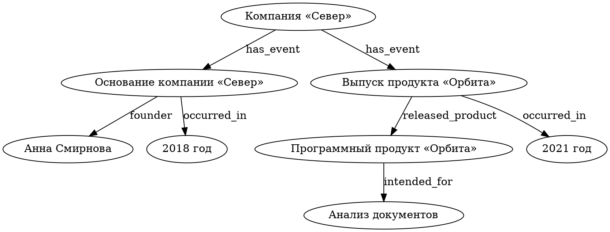

# Семантическая модель графа

**Версия документа:** 1.2  
**Статус:** утверждённая спецификация MVP  
**Версия схемы графа:** `1`

## 1. Назначение

Документ определяет единую доменную модель знаний, извлекаемых из текста: состав графа, типы сущностей, структуру утверждений, идентификаторы, метаданные происхождения фактов и инварианты валидации.

Семантический граф — направленный мультиграф. Его узлы представляют сущности и значения, а связи — утверждения вида **«субъект — отношение — объект»**. Граф допускает циклы, петли и параллельные связи. Он не является деревом.

В Python граф представлен типизированными объектами `SemanticGraph`, `SemanticNode` и `SemanticEdge`. При сохранении используется один локальный DOT-файл. Правила синтаксиса DOT, экранирования и канонической сериализации определены в `docs/dot-storage.md`; семантическое значение полей задаётся настоящим документом.

## 2. Граф — `SemanticGraph`

| Поле | Тип | Обязательность | Ограничение |
|---|---|---|---|
| `schema_version` | `str` | Да | Ровно `"1"` |
| `revision` | `int` | Да | Неотрицательное целое число |
| `nodes` | коллекция `SemanticNode` | Да | ID узлов уникальны |
| `edges` | коллекция `SemanticEdge` | Да | ID связей уникальны |

Новый граф создаётся с `schema_version = "1"` и `revision = 0`. Каждое успешное сохранение семантического изменения увеличивает ревизию на единицу. Повторное сохранение без изменения содержимого ревизию не увеличивает.

Метаданные графа записываются в DOT как `schema_version` и `revision`.

## 3. Узлы — `SemanticNode`

### 3.1. Структура

| Поле | Тип | Обязательность | Назначение |
|---|---|---|---|
| `id` | `str` | Да | Уникальный стабильный идентификатор |
| `name` | `str` | Да | Непустое человекочитаемое имя |
| `type` | `NodeType` | Да | Семантический тип узла |
| `description` | `str` | Нет | Краткое пояснение сущности |
| `value_kind` | `ValueKind` | Для узла `value` | Тип самостоятельного значения |
| `value` | `str` | Для узла `value` | Каноническое строковое представление значения |

`id` не зависит от имени и сохраняется при переименовании. Равные имена не означают тождественность сущностей.

`name` — отображаемое имя; в DOT оно хранится как `label` узла.

### 3.2. Типы узлов — `NodeType`

| Код | Смысл | Пример |
|---|---|---|
| `object` | Физический или цифровой объект, продукт, документ | Продукт «Орбита» |
| `person` | Конкретный человек | Анна Смирнова |
| `organization` | Организация, компания, учреждение | Компания «Север» |
| `event` | Событие или действие во времени | Выпуск продукта |
| `concept` | Понятие, дисциплина, назначение, процесс | Анализ документов |
| `value` | Значение свойства, представленное самостоятельным узлом | 2018 год |

`type` обязателен и принадлежит указанному закрытому набору. Неизвестный тип не заменяется автоматически другим типом.

### 3.3. Типы значений — `ValueKind`

Для узлов с `type = "value"` обязательны `value_kind` и `value`.

| Код | Содержание | Пример `value` |
|---|---|---|
| `text` | Произвольная строка | `активен` |
| `integer` | Целое число | `12` |
| `decimal` | Десятичное число | `12.5` |
| `boolean` | Логическое значение | `true` или `false` |
| `year` | Календарный год | `2018` |
| `date` | Дата в ISO 8601 | `2018-04-12` |
| `datetime` | Дата и время в ISO 8601 с часовым поясом | `2018-04-12T10:30:00+03:00` |
| `quantity` | Величина с единицей измерения | `12 kg` |

Канонические значения проверяются согласно `value_kind`. У других типов узлов поля `value_kind` и `value` запрещены.

`name` узла-значения может быть более удобным для чтения, чем `value`: например, `name = "2018 год"`, `value_kind = "year"`, `value = "2018"`.

## 4. Связи — `SemanticEdge`

### 4.1. Структура

| Поле | Тип | Обязательность | Назначение |
|---|---|---|---|
| `id` | `str` | Да | Уникальный стабильный идентификатор связи |
| `source_node_id` | `str` | Да | ID исходного узла — субъект |
| `target_node_id` | `str` | Да | ID целевого узла — объект |
| `relation` | `str` | Да | Непустой код семантического отношения |
| `evidence` | `str` | Нет | Краткий дословный фрагмент текста в поддержку утверждения |
| `source_ref` | `str` | Нет | Стабильный идентификатор источника |
| `confidence` | `float` | Нет | Уверенность извлечения в диапазоне от `0.0` до `1.0` включительно |

Связь всегда направлена от `source_node_id` к `target_node_id`; направление не предполагает обратной связи.

Оба узла должны существовать в графе как явные объявления.

`relation` — машинно-читаемый код в `snake_case`, соответствующий шаблону `[a-z][a-z0-9_]*`.

Словарь отношений открыт; новые отношения могут появляться без обновления версии схемы, если их смысл однозначен.

`confidence` оценивает надёжность извлечения именно данного утверждения из источника, а не вероятность его объективной истинности. Если оценка не предоставлена, поле отсутствует; значение `1.0` по умолчанию не подставляется.

`evidence` не должен содержать вымышленного текста. Если источник неизвестен, `source_ref` отсутствует.

### 4.2. Несколько источников и противоречия

Каждая связь фиксирует одно утверждение и не более одного набора `evidence`, `source_ref`, `confidence`.

Если одно утверждение подтверждается двумя независимыми источниками, допустимы две параллельные связи с одинаковыми концами и `relation`, но разными `id` и метаданными.

Противоречащие утверждения хранятся раздельно, вместе с их происхождением. Добавление нового утверждения само по себе не удаляет старое. Отсутствие утверждения во входном тексте не означает его ложность.

## 5. Факты и узлы-значения

Основная единица знания — направленная связь `SemanticEdge` между двумя узлами.

Например:

`Компания «Север» — founded_in → 2018 год`

Значения, существенные для ответов, сопоставления, обновления и подтверждения фактов, оформляются узлами типа `value`, а не произвольными атрибутами организаций или людей.

В частности, годы, даты, числа и состояния, упоминаемые как факты, представлены отдельными узлами и связями.

Для событий с несколькими участниками или характеристиками рекомендуется узел типа `event`: он связывается с организацией, участниками, продуктом и временем отдельными утверждениями.

Это позволяет хранить подтверждения для каждого отношения и не смешивать различные события.

## 6. Идентификаторы и ограничения

ID узла, ID связи и `source_ref` не несут семантического значения.

Для ID узлов и связей используется шаблон `[A-Za-z][A-Za-z0-9_-]*`; сравнение чувствительно к регистру.

Пространства ID узлов и связей независимы. ID присваивается при создании и не изменяется при переименовании.

Идентичность сущностей определяется явно: совпадение имён, типов или контекста может быть признаком для `EntityResolver`, но не является достаточным условием для автоматического объединения. При неоднозначности сохраняются раздельные сущности или возвращается запрос на уточнение.

Граф допускает:

- любое количество узлов каждого разрешённого типа, включая пустой граф;
- циклы и петли;
- параллельные связи с различными ID;
- повторное использование одного узла-значения несколькими утверждениями;
- разные утверждения об одной сущности, включая конфликтующие.

## 7. Представление в DOT

Для файла используется один именованный `digraph "semantic_graph"`.

Поля отображаются без дублирования:

| Поле доменной модели | Представление DOT |
|---|---|
| `SemanticGraph.schema_version` | Атрибут графа `schema_version` |
| `SemanticGraph.revision` | Атрибут графа `revision` |
| `SemanticNode.id` | Идентификатор объявления узла |
| `SemanticNode.name` | Атрибут узла `label` |
| `SemanticNode.type` | Атрибут узла `type` |
| `SemanticNode.description` | Атрибут узла `description` |
| `SemanticNode.value_kind` | Атрибут узла `value_kind` |
| `SemanticNode.value` | Атрибут узла `value` |
| `SemanticEdge.source_node_id` | Левая сторона `source -> target` |
| `SemanticEdge.target_node_id` | Правая сторона `source -> target` |
| `SemanticEdge.id` | Атрибут ребра `id` |
| `SemanticEdge.relation` | Атрибут ребра `label` |
| `SemanticEdge.evidence` | Атрибут ребра `evidence` |
| `SemanticEdge.source_ref` | Атрибут ребра `source_ref` |
| `SemanticEdge.confidence` | Атрибут ребра `confidence` |

Все значения атрибутов и идентификаторы записываются как строки в двойных кавычках.

`revision` записывается десятичным целым числом без ведущих нулей; `confidence` — десятичным числом от `0` до `1`.

Отсутствующие необязательные поля не сериализуются. Поля, не определённые настоящей спецификацией, не принимаются.

Загрузка и сохранение должны быть без потери полей. Перед публикацией или записью граф проходит валидацию. Сериализация детерминирована, а запись файла атомарна.

## 8. Валидация

`GraphValidator` проверяет:

1. Поддерживаемую `schema_version`, допустимую `revision`.
2. Уникальность ID узлов и ID связей в соответствующих пространствах.
3. Синтаксис ID; непустые `name` и `relation`; допустимые `type`.
4. Для `value` — наличие и корректность `value_kind` и `value`; для остальных типов — отсутствие этих полей.
5. Существование явно определённых исходного и целевого узлов каждой связи.
6. Диапазон и конечность `confidence`, когда поле присутствует; значения `NaN` и бесконечность недопустимы.
7. Корректность всех предусмотренных полей без молчаливой потери неизвестных данных.

При обнаружении ошибки сохранение отклоняется целиком.

Синтаксические ограничения и диагностика файла DOT определяются `docs/dot-storage.md`.

Изменения графа применяются только через проверенный `GraphPatch` к независимой копии графа; после применения выполняется повторная проверка инвариантов.

## 9. Пример построения модели

**Исходный текст:**

> Компания «Север» основана Анной Смирновой в 2018 году. В 2021 году компания выпустила программный продукт «Орбита». Продукт предназначен для анализа документов.

**Интерпретация:** организация, человек, два события, продукт, два года и понятие анализа документов становятся восемью узлами.

Семь связей описывают организацию событий, участников, время, результат и назначение продукта. Каждая связь имеет собственное подтверждение и общий источник `doc_example_001`.

Ниже приведено полноценное сохраняемое представление семантической модели. Значения `confidence` демонстрационные.

## 10. Разделение ответственности

- `SemanticNode`, `SemanticEdge` и `SemanticGraph` — типизированные структуры данных.
- `GraphValidator` — детерминированная проверка доменных инвариантов.
- `EntityResolver` — сопоставление извлечённых сущностей с существующими ID.
- `SubgraphSelector` — выделение релевантного подграфа без изменения оригинала.
- `PatchPlanner`, `PatchValidator`, `PatchApplier` — подготовка, проверка и атомарное применение изменений.
- `DotCodec` — чтение и запись поддерживаемого DOT без потери атрибутов.
- `GraphRepository` — хранение, проверка ревизии и атомарная запись файла.
- `SemanticExtractor` — получение кандидатов узлов и связей из текста с указанием доступных подтверждений; непосредственно граф не изменяет.

Схемы LLM-сообщений определяет `docs/llm-contracts.md`, формат патчей — `docs/graph-patches.md`, правила DOT-файла — `docs/dot-storage.md`, взаимодействие компонентов — `docs/architecture.md`.